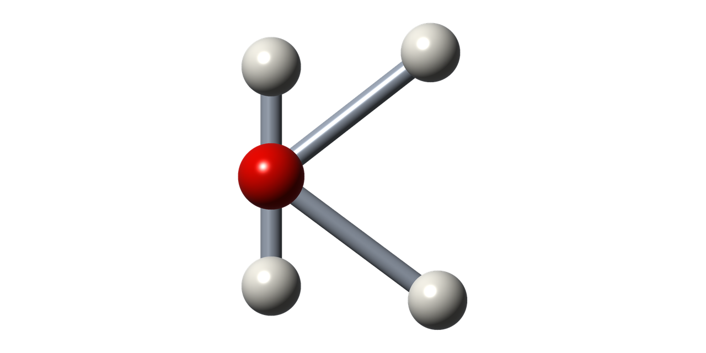
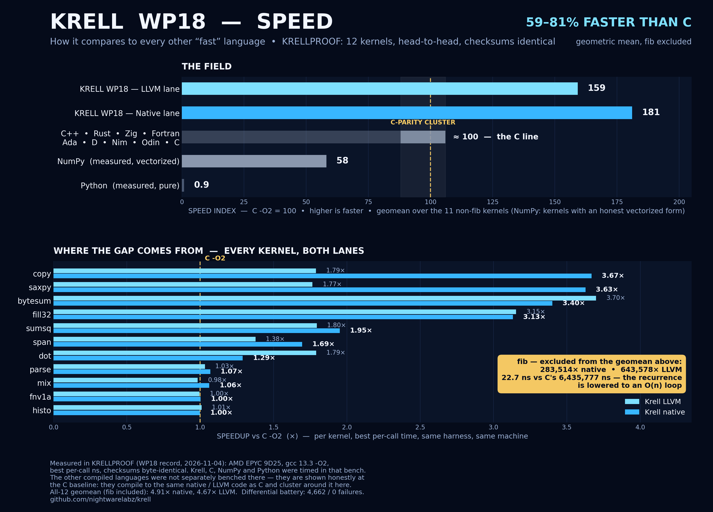

<p align="center">
  
</p>

# Krell

**A machine-facing portable assembly.** Krell is a program representation
that sits between assembly and C: the raw power and speed of assembly,
with the portability of C — designed from the start for machines, not
humans, to produce and consume. Producers are compilers, superoptimizers,
and automated agents; the format, semantics, and tooling are all shaped
for them.

```text
one program, written once  ──►  Krell-IR (binary, hashed, verified)
                                   ├── x86_64   native backend
                                   ├── AArch64  native backend
                                   ├── RISC-V   native backend (RV64)
                                   └── LLVM IR  lowering lane (release)
```

https://github.com/user-attachments/assets/190e80ad-22b0-42c4-b54a-ec2029634b4d

*Every frame of this film was computed by a single Krell program.*

## Design

- **Typed SSA with block arguments** — infinite virtual registers,
  explicit blocks, no phi nodes; the form four independent IR designs
  converged on, because it is the one that works.
- **Total semantics** — every operation is defined for every input.
  Division by zero is 0, `INT_MIN / -1` wraps, shifts mask their amount,
  float→int conversions saturate and map NaN to 0. There is no undefined
  behavior and no poison, so translation validation stays decidable and
  the specification (`docs/SEMANTICS.md`) is small enough to encode.
- **Backend-owned ABI** — backends own register allocation, instruction
  selection, and the C calling convention for their target; producers
  never reimplement an ABI.
- **Curated op set** — the instruction set is the intersection of
  operations that are efficient on every target, plus predicated
  escape hatches where the intersection is empty.
- **A shipped cost oracle** — every target carries a machine-readable
  cost table (`targets/*.cost`: latency, throughput, and *cliff* flags
  for operations with no reasonable implementation). The verifier
  rejects modules that use cliff operations for a target, and the
  optimizer prices its rewrites from the same tables.
- **Machine-first binary encoding** — canonical, hash-consed, and
  content-addressed: a module's SHA-256 over its canonical encoding is
  its identity. Round-trips are byte-identical by construction.
- **A reference interpreter** — the semantics document made executable;
  every backend is differentially tested against it.

## Layout

```text
src/        the toolchain (C11, no dependencies beyond libc/libm)
  krell.h     public API: IR, builder, binary format, verifier,
              cost oracle, interpreter, optimizer, backends
  ir.c        IR core: builder, hash-consing, constant folding
  binary.c    canonical binary encoding + SHA-256 module identity
  verify.c    structural/type/dominance verifier + target gate
  cost.c      per-target cost oracle
  interp.c    reference interpreter
  opt.c       optimizer (rewrites, magic-number division, DCE)
  surface.c   human surface syntax (debugging/authoring aid)
  be.c        shared backend kit: liveness, linear-scan allocation
  be_x86.c    x86_64 backend (System V)
  be_arm64.c  AArch64 backend (AAPCS64, ARMv8.1 baseline)
  be_rv64.c   RISC-V RV64 backend (lp64d, RV64GC + Zbb, scalarized vectors)
  be_llvm.c   LLVM IR lowering lane
  main.c      the krellc driver
targets/      cost oracle tables (x86_64, aarch64, riscv64)
tests/        kernel suite, differential battery, fuzz harness
tools/        fragment superoptimizer, random-module fuzzer
docs/         SEMANTICS.md (normative), SPEC.md (formats)
brand/        the Krell mark
```

## Build

```sh
make            # libkrell.a + krellc
make tests      # kernel suite + binary round-trip gate
```

## Use

```sh
krellc parse  prog.txt -o prog.krel        # surface syntax -> binary
krellc verify prog.krel --target riscv64   # verify + target gate
krellc run    prog.krel sumsq 100          # interpret: 338350
krellc build  prog.krel --target x86_64 -o prog.s
krellc build  prog.krel --target llvm -O -o prog.ll
krellc opt    prog.krel -o prog.opt.krel   # optimize
krellc hash   prog.krel                    # canonical module identity
```

Differential gates (battery of ~4,500 recorded cases per backend,
plus a random-module fuzzer) run from `tests/`:

```sh
tests/run_backend.sh x86     # also: arm, rv, llvm
tests/run_fuzz.sh x86 12345 opt
```

## Performance

Measured against C (gcc 13.3, `-O2`) on the twelve
[KRELLPROOF](https://github.com/nightwarelabz/krellproof) kernels —
the same workloads written once in Krell and once in C, timings
recorded only where the implementations' checksums agree. S is the
per-kernel speedup T_C / T_Krell; the figures below are geometric
means of S from the recorded run of 2026-11-04 (bench host: AMD
EPYC 9D25; the LLVM lane of that run was built with clang 18).



| lane | S, all twelve kernels | S, excluding fib |
|---|---|---|
| x86_64 native | 4.91× — 391% faster than C | 1.81× — 81% faster than C |
| LLVM | 4.67× — 367% faster than C | 1.59× — 59% faster than C |

fib is quoted both ways because it dominates any mean it joins:
the optimizer lowers its two-term recurrence to an O(n) loop —
22.7 ns native and 10.0 ns through the LLVM lane in this run,
against 6,435,777 ns for C -O2 (the native fib row varies with
bench-binary layout; the WP17 record read 53.4 ns on unchanged
emitted code).

Per-kernel speedups (native / LLVM): copy 3.67× / 1.79×,
saxpy 3.63× / 1.77×, bytesum 3.40× / 3.70×, fill32 3.13× / 3.15×,
sumsq 1.95× / 1.80×, span 1.69× / 1.38×, dot 1.29× / 1.79×,
parse 1.07× / 1.03×, mix 1.06× / 0.98×, fnv1a 1.00× / 1.00×,
histo 1.00× / 1.01×.

Two optimization rounds have landed since that run. WP19 raised the
optimizer's unroll factor for 64-bit scalar reductions (dot, sumsq),
widened the counted-loop unroller, strength-reduced small constant
multiplies in the x86_64 emitter (LEA and shift forms in place of
imul), and aligned function entries and loop heads to 16 bytes.
WP20 taught the x86_64 emitter to fold chains of address adds into
addressing displacements, skipping the intermediate adds entirely.
Measured by interleaved A/B against the previous compiler with
identical checksums, WP19 brought dot ~+15% and sumsq ~+25%, and
WP20 brought sumsq a further ~+10%, mix ~+10%, and span ~+4%, with
parse byte-identical. A KRELLPROOF record incorporating both rounds
is pending a certified draw; the table above remains the current
record.

The full record — kernels, C references, methodology, per-run
results and charts — lives in the
[krellproof](https://github.com/nightwarelabz/krellproof)
repository.

## License

Apache-2.0 (see `LICENSE` and `NOTICE`).

**Toolchain output carries no obligations.** Programs encoded in Krell
form, and code produced by compiling them with this toolchain, are
outputs of the toolchain. The Apache-2.0 license of the toolchain
itself imposes no license obligations on those outputs: you may use,
modify, and distribute Krell-encoded programs and their compiled forms
under any terms you choose.
